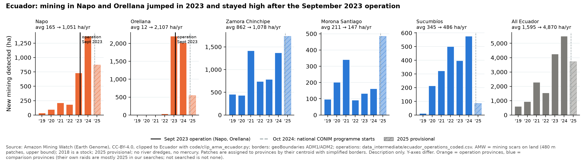
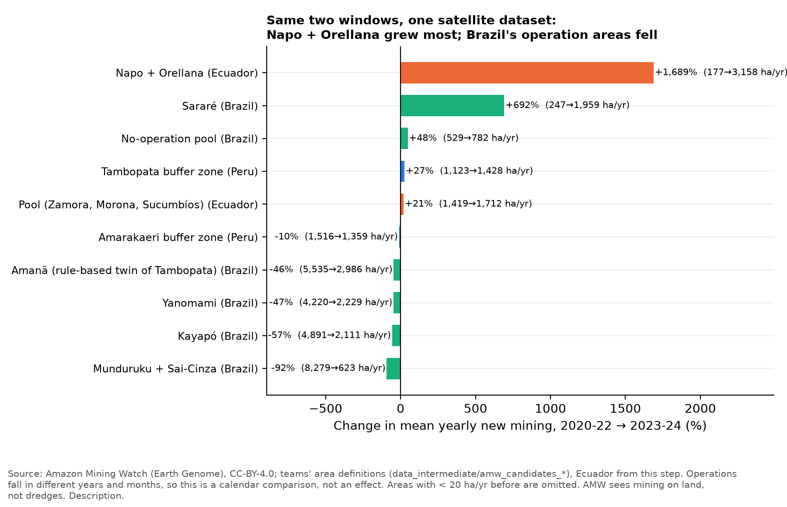

# Mercurio cut new mining where it struck, for three years. The region kept growing. Ecuador's 2023 operation met a surge, and mining stayed high after it.

> **Version 2 (2026-10-12): adds the Ecuador case (Napo and Orellana, operation of September 2023) to every step and compares it with Peru and Brazil.** Everything Ecuadorian uses Amazon Mining Watch only, so the Ecuador windows are short. Not reviewed by the team. A guided walk through the analysis, in plain words. Each step says what we asked, what we did, where the code is, how to read the figure and why it matters. Section 16 holds the report draft. Every number comes from `output/numbers.csv`. Nobody has checked this yet: treat it as a draft.

## 1. The bottom line

**Operation Mercurio worked locally, and only for a while.**

- **During (2019–21):** new mining in the targeted zone fell from 1,640 to 163 ha per year. Every one of those years was lower than any year from 2011 to 2018. **[description]**
- **Against other Peruvian zones:** no other zone fell like this, with or without controls for the gold price, trends and size. **[description]**
- **Against Ruby's rule-based twin:** the closest match in the whole Amazon (Amanã, Brazil) grew like Tambopata until 2018. In 2019–21, Tambopata added mining at 38% of the twin's pace. **[description]**
- **After (2022–25):** Tambopata came back to 1,829 ha per year. The extra fall is gone. **[description]**
- **Around it:** Madre de Dios as a whole did not fall: 3,610 → 4,640 → 12,049 ha per year. **[description]**
- **Inside the reserve:** small, but new in 2025 (+241 ha). **[description]**
- **Brazil:** territories fell after operations, while territories without one grew. But the timing is not clean enough to credit single operations. **[description]**
- **Ecuador (new):** in Napo and Orellana, new mining rose from 177 ha per year (2020–22) to 3,158 (2023–24), about 18 times, while the operation took place in September 2023. Mining in the three comparison provinces rose 21%. At least part of the jump came before the operation (it destroyed machinery at working sites). AMW has no month, so we cannot say how much. 2024 was higher than 2023. Only the provisional 2025 figure (1,421 ha, 45% of the 2023–24 average) points down, and it needs confirming. **[description]**

**Can we say Mercurio *caused* the fall?** Cautiously, yes, for 2019–21 only. Two independent comparisons agree: 14 other Peruvian zones (steps 6–7) and a twin picked by rules abroad (step 8). One targeted zone still leaves room for luck or a local shock. We label it a **conditional causal claim**. **[causal]**

**What was the effect of enforcement in Ecuador?** We cannot say. The operation destroyed machinery at sites that were already working, so the surge was at least partly there first (possible reverse causation). Nothing in the data shows a fall right after September 2023, and from October 2024 the whole country is under a national programme, so no province is a clean comparison. Peru's cautious causal claim does **not** carry over. **[description]**

**Why it matters:** FZS should expect enforcement to work **while it lasts** and **where it lands**. It should not expect the region to mine less. Ecuador adds a warning: an operation that arrives *on top of* a surge may not show up as a fall for a year or more.

> **One correction from last night still stands.** "Pre-trends fail" came from one odd year: 2016 (707 ha, then 2,455 ha in 2017). Averaged over several years, the fake-date test passes (step 7).

## 2. How to read this page

**Steps 3–13 walk through the analysis.** Each answers one question, and each now ends with a **Ecuador, same step** box that repeats the step for the Ecuadorian case (or says why it cannot be repeated):

- **3** What is the question, and where?
- **4** What exactly do we measure?
- **5** The basic comparison
- **6** Is the fall special, or just noise?
- **7** Controls: gold price, trends, size
- **8** Ruby's idea: one real twin, picked by rules *(new)*
- **9** Add-on: a synthetic twin
- **10** Where did the mining go?
- **11** Did it move into the reserve?
- **12** A cross-check with gold production
- **13** Brazil: staggered operations *(rebuilt)*

Then: **Ecuador side by side (14)**, what we can claim (15), **the report draft (16)**, where everything lives (17), what's on you (18), appendix (19).

**Plain-word glossary**

| Term | Meaning here |
|---|---|
| **Buffer zone** | The ring of land around a protected area. La Pampa lies in Tambopata's buffer zone. |
| **New mining (additions)** | Mining area this year minus last year, in hectares (ha). 1 ha = 100 × 100 m. |
| **Targeted zone** | Tambopata buffer zone, hit by Mercurio from February 2019. |
| **Comparison zone** | A zone that shows what *might* have happened without the operation. |
| **Before / during / after** | 2016–18 / 2019–21 / 2022–25. |
| **Gap change** (difference-in-differences) | (targeted after − before) − (comparison after − before). |
| **Zone and year effects** (fixed effects) | A regression that removes each zone's normal level and each year's shared shock. |
| **Fake date** (placebo in time) | Pretend the operation started in 2016. A good method finds little. |
| **Fake place** (placebo in space) | Pretend each other zone was the target. Tambopata should stand out. |
| **Rule-based twin** (Ruby's idea) | One real area, picked by fixed rules before looking at results. |
| **Synthetic twin** (synthetic control) | A weighted mix of zones built to copy Tambopata before 2019. |
| **MapBiomas** | Yearly land-cover maps from satellites; our main measure (Peru: Collection 4). |
| **AMW** (Amazon Mining Watch) | A second satellite product: gold-mining scars across the whole Amazon, from 2018. For Ecuador it is our **only** product. |
| **Ecuador pool** | Zamora Chinchipe, Morona Santiago and Sucumbíos: Amazon provinces with mining and no operation we could date before 2025. |
| **Share of 2018 stock** | New mining per year divided by the mining already present in 2018. Lets us compare a small area with a big one. |

**Claim labels.** The brief must label every claim: **[description]** = what happened; **[prediction]** = what we expect; **[causal]** = what caused it.

## 3. The question: what happens in and around a target when enforcement ends?

**What FZS asked:** Christof Schenck's team supports enforcement patrols around Tambopata. They want to know what to expect when an operation ends.

**What we did:** We followed one operation in two countries:

- **Peru:** Operation Mercurio, February 2019, at La Pampa in the Tambopata buffer zone.
- **Brazil:** the Yanomami operation, February 2023.

**The places in Peru:**

- **Targeted:** Tambopata buffer zone.
- **Main comparison:** Amarakaeri buffer zone (nearby, mining, no Mercurio).
- **Also tracked:** Tambopata National Reserve itself, the rest of Madre de Dios, 13 other Peruvian buffer zones with mining, and a rule-based twin abroad (step 8).

**How to read it:** Coloured dots are mining patches from Amazon Mining Watch, coloured by the year they first appear. Outlined areas are reserves, buffer zones and the legal mining corridor.

**What it shows:** Most mining sits in the legal corridor and around La Pampa. The newest patches (2025–26) hug the northern edge of the reserve. **[description]**

**Why it matters:** The target is small, and mining sits right next to it. Moving a few kilometres is easy for miners.

**Code:** `code/spatial.py`.

**Ecuador, same step: where and what.**

- **Targeted:** Napo and Orellana provinces. Operation of 21–22 September 2023 (Armed Forces statement, via Primicias): more than 1,000 personnel, backhoes destroyed at Punino Alto (Orellana) and Talag (Napo). **One** report (Cuenca Dispatch) dates a Napo operation to May 2023. We could not settle the conflict, so we treat 2023 as "the operation year". The yearly design is not affected.
- **Comparison:** Zamora Chinchipe, Morona Santiago and Sucumbíos ("pool"). Our searches found their first dated raids in **2025** (Zamora May, Morona November, Sucumbíos August). "Not searched" is not "none".
- **Not a clean untreated group after October 2024:** a national committee (CONIM) reports 60 operations since then (Vistazo, March 2025).
- **Borders:** province and canton borders from geoBoundaries. The Natural Earth map swaps Napo and Tungurahua, so we did not use it (checked with town positions).

**Code:** `code/ecuador.py`. Operations: `data_intermediate/ecuador_operations_coded.csv`.

## 4. What we measure: new mining per year, not total mining

**The rule:** We count the **new** mining area each year (this year's mining minus last year's). The course requires this, because totals only grow and track the gold price.

**Data:** MapBiomas Peru, Collection 4, the "mining" land class, from satellite maps.

**Limits:**

- Legal and illegal mining look the same.
- River dredges and mercury are invisible.
- Re-mining an old site can count as new.

**How to read it:**

- **Top:** new mining per year in three buffer zones.
- **Middle:** the whole department and the "rest" (department minus all buffer zones).
- **Bottom:** gold price.
- **Red line:** Mercurio. Grey dashed lines: COVID, Plan Restauración and the 2023 state of emergency.

**What it shows:**

- Tambopata drops to almost nothing in 2019–21, then jumps in 2023.
- Every series spikes in 2023.
- The gold price rose 2.7× from 2018 to 2025, but only 8% in 2023 itself. **[description]**

**Why it matters:** Several events overlap. A simple "before vs after" in one zone can't separate them, so we need comparison zones.

**Code:** `code/peru.py` (`build_series`, `fig_additions`).

**Ecuador, same step: what we measure.** Same rule (new mining per year), but a different satellite product. MapBiomas for Ecuador is not in our data pack, so we use **Amazon Mining Watch (AMW)**: 480 m patches, onset year 2018–2026. Consequences:

- **2018 is a stock**, not new mining. The first usable year is 2019, so we have a pre-period of 2020–22 only.
- **2025 is provisional** (a patch must be confirmed a year later). All 2025 patches in both groups are provisional, so the two groups are treated alike.
- **AMW is an upper bound** and cannot see river dredges, which Ecuadorian reports mention.
- The extract holds 1,828 patches. 1,608 fall inside an Ecuadorian province. The rest are slivers of Colombia and Peru. The count equals a direct read of the full AMW file (232,030 patches, same file as the team's 2026-10-10 download).

**How to read it:** Bars are new mining per year (2025 provisional, hatched). Orange = provinces with the September 2023 operation (black line). Blue = comparison provinces. The dashed line is October 2024, when the national programme began. Each panel has its own scale.

**What it shows:**

- **Napo and Orellana were nearly flat until 2022** (35–219 ha per year), then jumped: 2,930 ha in 2023 and 3,385 in 2024. **[description]**
- **The comparison provinces move up and down** (Zamora Chinchipe peaked in 2021 and again in 2025 (provisional)) but never jump like this. **[description]**
- **The gold price rose 21%** between 2020–22 and 2023–24 (nominal USD). That is far too small to explain a jump of about 1,700%. **[description]**

**Why it matters:** At least part of the surge was **already there** when the operation came: it destroyed machinery at working sites, and the series kept rising in 2024. AMW has no month, so the split of 2023 is unknown. That is the opposite of Peru, where the series starts high and then falls.

## 5. The basic comparison: Tambopata fell, Amarakaeri rose

**Question:** Did the targeted zone change differently from a similar zone nearby?

**What we did:** We averaged new mining per year in each period and compared the changes. This is the course's starter comparison.

| ha of new mining per year | Before 2016–18 | During 2019–21 | Change |
|---|---:|---:|---:|
| Tambopata (targeted) | 1,640 | 163 | −1,477 |
| Amarakaeri (comparison) | 289 | 574 | +285 |
| **Gap change** | | | **−1,762** |

**How to read it:**

- **Top:** dots are yearly values. Thick bars are the period averages (before, during, after).
- **Bottom:** the whole department and the rest.

**What it shows:**

- Tambopata collapses during 2019–21 and returns after.
- Amarakaeri and the rest of the department rise. **[description]**

**Two quick tests:**

- **Fake date** (pretend the operation began in 2016): gap change 209 ha/yr. Small next to −1,762. **[description]**
- **Longer "before"** (2014–18): −1,663 ha/yr. Almost the same. **[description]**

**Why it matters:** This is the clearest single number for the brief. It is still only a description: Amarakaeri is one zone, it may have received miners from Tambopata, and it had its own enforcement.

**Code:** `code/peru.py` (`describe_and_compare`). Table: `output/fig_peru_did_table.csv`.

**Ecuador, same step: the basic comparison.** Same 2×2, but with the windows AMW allows: before = 2020–22, after = 2023–24.

| ha of new mining per year (AMW) | Before 2020–22 | After 2023–24 | Change |
|---|---:|---:|---:|
| Napo + Orellana (operation Sept 2023) | 177 | 3,158 | +2,981 |
| Pool: Zamora Ch., Morona S., Sucumbíos | 1,419 | 1,712 | +293 |
| **Gap change** | | | **+2,688** |

**Reading across all areas.** Peru's gap change was **−1,762 ha per year** (MapBiomas, 2016–18 vs 2019–21). Ecuador's is **+2,688** (AMW, 2020–22 vs 2023–24). Different satellite products and windows: **compare the signs and the story, not the hectares.** In Peru, mining fell where the operation landed. In Ecuador, it rose by an order of magnitude.

**Two quick tests, Ecuador version:**

- **Fake date** (pretend the operation started in 2021, before = 2019–20, after = 2021–22): Napo + Orellana minus pool = 0.30 log points, against 2.70 for the real date. **[description]**
- **Provisional 2025 included** (after = 2023–25): 2.38 log points. The gap shrinks as 2025 enters. **[description]**

**Why it matters:** Unlike Peru, there is no operation-year *fall*. The effect of the operation cannot be read from this table. See step 14.

**How to read it:** Each bar is the change in mean yearly new mining between 2020–22 and 2023–24, measured by AMW everywhere. Orange = Ecuador, blue = Peru, green = Brazil. Areas with fewer than 20 ha per year before are omitted (Orellana alone, which starts from 12 ha, is part of Napo + Orellana).

**What it shows:**

- **Ecuador's operation provinces grew most:** +1,689%. **[description]**
- **Brazil's operated territories fell:** Yanomami −47%, Munduruku + Sai-Cinza −92%, Kayapó −57% (operation in 2024, inside the window). **[description]**
- **Peru and the Ecuador pool moved little:** Tambopata buffer zone +27%, Amarakaeri −10%, Ecuador pool +21%. **[description]**
- **Not a "sign of success":** the window straddles different operation dates, and a rise in a small area is a large percentage. See "share of 2018 stock" in step 8.

## 6. Is the fall special, or just noise? Year by year, against every zone

**Question:** Is Tambopata's 2019–21 drop bigger than the normal ups and downs of any zone?

**What we did:** an **event study**. For each year, we measure how far Tambopata sits above or below the comparison zones, relative to 2018. Then we repeat it pretending each of 14 other zones was the target (the grey band).

**Model:** new mining = zone effect + year effect + one Tambopata-specific term per year (2018 left out). Estimated with `pyfixest`.

**How to read it:**

- **Red dots:** Tambopata vs the two other Madre de Dios zones with mining.
- **Blue squares:** Tambopata vs all 14 Peruvian zones with mining.
- **Grey band:** the range you get by pretending each other zone was targeted.
- A dot far below the band means "nothing else moved like this".

**What it shows:**

- 2019–22 sit far below the band: Tambopata ranks **1st of 15** zones. **[description]**
- 2023 is inside the band again. **[description]**
- 2016 also dips (−1,195 ha). That is one low year (707 ha) between two high ones, not a trend. **[description]**

**Why it matters:**

- With one targeted zone, normal error bars mean nothing. The fake-place ranking is our honest substitute.
- Ranking 1st of 15 would happen by chance about 1 time in 15 (~7%).

**Code:** `code/peru.py` (`run_event_study`, `placebo_restricted`). Output: `output/peru_event_study.csv`, `output/peru_placebo_in_space.csv`.

**Ecuador, same step: is the jump special or noise?** A year-by-year event study needs many pre-years and many comparison zones. AMW gives four usable pre-years (2019–22) and Ecuador has five provinces with mining, so we do the honest small version:

- **Index (2020–22 average = 100):** Napo + Orellana 124 (2022) → **1,660 (2023)** → **1,918 (2024)** → 805 (2025, provisional). Pool: 94 → 93 → 149 → 163. **[description]**
- **Fake places, Ecuador version:** among all 43 AMW areas in the Amazon that had at least 100 ha of new mining per year in 2020–22, Napo + Orellana has the **largest growth: rank 1 of 43**. The 43 areas overlap (protected areas, territories, buffer zones), so this is a ranking, not a probability. **[description]**
- **The same ranking as a share of 2018 stock** (51 areas with at least 100 ha of stock): rank 1 again. **[description]**
- **Leaving out one comparison province at a time:** gap 2.62 to 2.75 log points, so no single province drives it. **[description]**
- **Not done:** a year-by-year placebo band like Peru's (needs MapBiomas from 2011), and 15-zone models.

Files: `output/ecuador_index_2020_22_eq_100.csv`, `ecuador_space_placebo_top25.csv`, `ecuador_stock_rank_top15.csv`, `ecuador_gap_specs.csv`.

## 7. Controls: does the gold price, a trend or zone size explain the fall? No.

**Your question:** "Did the models control for the gold price?" **Yes, in two ways.**

1. **Year effects already remove the gold price.** The price is the same for every zone in a given year. So anything that hits all zones in a year (gold price, COVID, national policy) cancels out. The 2×2 comparison in step 5 cancels it the same way.
2. **But big mining zones may react more to a price rise.** So we added a control for that (M2 below).

**What we did:** We ran four models on all 15 Peruvian buffer zones with mining, 2014–2025. Each was run three ways: with the real date, with a fake 2016 date, and with each other zone as the fake target.

| Model | What it adds | During 2019–21 | After 2022–25 | Fake 2016 | Rank |
|---|---|---:|---:|---:|---:|
| **M1** | Zone + year effects (gold price, COVID as shared shocks) | −1,454 | 161 | 255 | 1 of 15 |
| **M2** | + bigger zones react more to gold price | −1,605 | −175 | 187 | 1 of 15 |
| **M3** | + each zone's own trend | −1,859 | −599 | −337 | 1 of 15 |
| **M4** | Scaled to each zone's size (1 = a normal pre-2019 year) | −1.45 | −0.20 | −0.33 | 1 of 7 |

Units: ha per year (M1–M3); M4 is in "normal years". Negative = Tambopata fell more than the others.

**How to read it:** For each model, the gold bar is the real effect and the grey bar the fake-date effect. A trustworthy result has a long gold bar and a short grey bar.

**What it shows:**

- **During:** the gap is −1,454 to −1,859 ha per year (M1–M3). That is about one normal Tambopata year (1,594 ha in 2014–18) wiped out, every year. **[description]**
- The fake date is 4–9 times smaller and points both ways. **[description]**
- **After:** the gap shrinks to between −599 and +161, so the effect fades. **[description]**
- **Mean reversion?** Tambopata's highest year in 2019–21 (417 ha) was below its lowest year in 2011–18 (707 ha). Drifting back to normal can't explain a drop that far. **[description]**

**Why it matters:** This is our strongest evidence. It is what lets us make a careful causal statement for 2019–21:

> **[causal]** *If the other zones show what Tambopata would have done without Mercurio, the operation cut new mining there by roughly 1,450–1,860 ha per year in 2019–21. The cut did not last into 2022–25.*

**What still threatens it:**

- **One targeted zone.** Rank 1 of 15 can happen by chance (~7%).
- **Spillovers.** Miners pushed into Amarakaeri make the gap look bigger. M1–M4 use 14 zones, mostly far away, so this matters less.
- **Anything else that hit only Tambopata in 2019.** COVID and the gold price hit all zones, but local events would not.
- **Measurement.** River dredges are invisible. A move from land to river would look like a fall.

**Code:** `code/peru_models.py` (new today). Output: `output/peru_models.csv`, `output/fig_peru_models.png`. Cross-checked: the numpy fit equals `pyfixest`.

**Ecuador, same step: controls (gold price, trend, size).**

- **Gold price (year effects):** all provinces share the same price. It rose 21% from 2020–22 to 2023–24 (World Bank, nominal). The pool rose 21% over the same windows, the same size as the price rise (a coincidence of size, not an explanation). A price rise of 21% cannot explain Napo + Orellana's +1,689%. **[description]**
- **Bigger areas react more (M2):** not testable with five provinces. Instead we scale: Napo + Orellana's new mining in 2023–24 was **870% of its own 2018 stock per year**. The pool: 222%. Tambopata: 6.7%; Amarakaeri 11.6%; Munduruku 7%; Kayapó 12%. Only Sararé (494%), Aripuanã (218%) and Yanomami (147%) come close among all the areas we have. **[description]**
- **Own trends (M3):** Napo + Orellana had a 2019–22 upward drift (35 → 219 ha), but nothing like the jump.
- **Mean reversion:** every 2019–22 year (35–219 ha) is far below every 2023–24 year (2,930 and 3,385 ha). **[description]**
- **The catch:** the stock in 2018 is only 363 ha. A base that small makes any percentage large. We report hectares and the share together.

**What this means for the claim:** these controls say the *surge* is not an artefact of the gold price or of size. They do **not** say anything about the operation's effect, because the comparison is a surge, not a fall.

## 8. Ruby's twin: no clean one exists; the closest one confirms the fall

**Bottom line:** No area in the Amazon passes all four rules. Relax one rule, and the best twin is **Amanã National Forest** in Brazil. It grew just like Tambopata until 2018. In 2019–21, Tambopata added new mining at 38% of the twin's pace. **[description]**

**The idea (Ruby):** Don't build a fake Tambopata. Find one existing area that passes four rules:

1. **R1 Mining before 2019:** at least 500 ha of mining seen by satellite by 2018.
2. **R2 No intervention:** no operation against mining reported in 2017–25.
3. **R3 Far enough away:** outside Madre de Dios, so La Pampa's miners can't simply walk over.
4. **R4 Geographic twin:** lowland mining like La Pampa (below 500 m), and at least a fifth of its size. The closest survivor wins.

**What we did:**

- **Map:** 1,174 protected areas, buffer zones and indigenous territories. Peru from the park service (SERNANP), the other eight countries from the Amazon network RAISG, Brazil's territories from FUNAI.
- **Mining (R1):** Amazon Mining Watch patches inside each area. One satellite product covers all nine countries.
- **Operations (R2):** a documented web search per candidate area, every query logged, including those with no hits.
- **Geography (R4):** elevation of each area's mining, from a public elevation service (OpenTopoData).

**How to read it:** Each bar is the number of areas left after one more rule. The scale is logarithmic.

**What it shows:**

- 31 areas had real mining before 2019. **[description]**
- Only 2 of them had no operation found, and both are small and unlike La Pampa. **[description]**
- 7 more could not be classified: the search was unclear. **[description]**

**Why it matters:** Almost every big mining area in the Amazon got an operation. An untouched twin of La Pampa does not exist. That is a finding about enforcement, not a failure of the method.

**How to read it:** Each dot is an area with at least 500 ha of mining by 2018. Dot size = mining area. Colour = its fate under the rules. Green shapes are protected areas.

**What it shows:**

- Peru outside Madre de Dios has **no** big mining area. The nearest rule-passing candidates are in Brazil. **[description]**
- The big candidates cluster in Brazil's Tapajós gold region. Nearly all had an operation, most in 2023. **[description]**

**Relax one rule, and a twin appears.** Ruby asked for "no intervention in the same period". So we require no operation only in **2017–21**: Mercurio's years and the two before. 3 areas pass. Best fit: **Amanã National Forest**.

| | Tambopata buffer zone | Amanã National Forest |
|---|---:|---:|
| Mining by 2018 (AMW, ha) | 21,362 | 23,916 |
| Median elevation of the mining (m) | 263 | 86 |
| Distance from La Pampa (km) | 0 | 1,511 |
| First operation found | Feb 2019 | Mar 2023 |

**How to read it:**

- **Left:** new mining per year as a share of each area's 2018 mining. Same satellite product for both, so the shares compare fairly.
- **Right:** total mining area, 2018 = 100. Each area comes from its own MapBiomas collection; they sit side by side and are never subtracted.

**What it shows:**

- **Before 2019, the two grew alike:** both stood at about half their 2018 size in 2014 (51 and 48). **[description]**
- **2019–21:** Tambopata added 7.9% of its 2018 mining per year; Amanã 20.9%. **[description]**
- **By 2021:** Tambopata's mining area was flat (104); Amanã's had grown to 165. **[description]**
- **After 2021, the twin is spoiled:** Amanã got its own operation in March 2023 and fell. Use it for 2019–21 only.

**Why it matters:** A second, independent comparison agrees with steps 5–7. Another country, another data source, picked by rules, not results. The 2019–21 fall is now much harder to dismiss.

**What still threatens it:**

- **Brazil weakened enforcement in 2019–22.** The twin may have grown faster than "normal", which flatters the gap.
- **"No operation found" is not proof of none.** Small patrols are often never published.
- **The two satellite products disagree on 2019.** AMW still sees a lot of new mining in Tambopata in 2019; MapBiomas sees little. Shares, not hectares, are compared here.

**Code:** `code/control_amw.py` (mining per area), `control_elevation.py`, `control_mb_amazonia.py`, `control_select.py` (the rules and figures). Output: `output/control_funnel.csv`, `control_compare.csv`. Operation searches: `docs/overnight/notes/control_interventions.csv`, coded in `data_intermediate/operations_coded.csv`.

**Ecuador, same step: is there a rule-based twin?** Apply Ruby's four rules to Ecuador (as the *treated* area):

- **R1 (at least 500 ha of mining seen by 2018):** Napo + Orellana had **363 ha**. They would have been filtered out as a treated candidate. That says something about the design: Peru's La Pampa case is a *large, old* mining area, Ecuador's is a *young* one.
- **Ecuador's own areas as twins:** only 5 of the 56 Ecuadorian protected areas in the RAISG set appear in our AMW table (the rest have no patch), and none comes close in size or timing (corridor RAISG-676 is the nearest, see step 11).
- **Twins from Peru and Brazil, same window (2020–22 → 2023–24):** Brazil's no-operation pool **+48%**; Amanã (Peru's twin) **−46%**, but Amanã had its own operation in March 2023, so it is spoiled for this window.
- **Reading:** against any out-of-country control, Ecuador's operation provinces grew more, by a wide margin. That is a description of a surge, not an effect of the operation.

## 9. Add-on: a synthetic twin. It fails for levels, works for shares.

**Bottom line:** A weighted mix of Peruvian zones cannot copy La Pampa's size, so this method only adds a weak extra check. **[description]**

**What it is:** Synthetic control builds a fake Tambopata from a weighted mix of other zones, fitted to the years before 2019. It differs from Ruby's idea: a mix of many zones instead of one real twin.

**How to read it:**

- **Left (A):** hectares. **Right (B):** each zone scaled to its own 2014–18 average.
- **Top:** gold line = real Tambopata; blue dashed = the synthetic copy. Before 2019 (shaded) they should overlap.
- **Bottom:** the gap between them. Grey lines = the same gap when each donor zone pretends to be the target.

**What it shows:**

- **In hectares, no fit.** Before 2019, Tambopata added 1,375 ha per year; the best mix only 32. Tambopata lay outside every other zone's range in 9 of 9 years. **[description]**
- **Scaled (B), a good fit.** Tambopata's 2019–21 dip is the deepest of 6 zones (rank 1). But 6 zones are too few to prove anything. **[description]**

**Why it matters:** You can't average small numbers into a big one. That is why steps 6–7 compare *changes*, and why step 8 had to look abroad.

**Code:** `code/peru_synth.py`.

**Ecuador, same step: a synthetic twin?** Not attempted. It needs a long pre-period and a donor pool that spans the treated area's size. AMW offers four pre-years and the Peruvian lesson (step 9) was that a mix of small areas cannot copy a big one. Napo + Orellana's pre-series (35–219 ha) is *inside* the donor range, so a fit would be easy. A good pre-fit proves nothing here, because the break is a surge unrelated to a donor pattern. Skipped on purpose, not forgotten.

## 10. Where did the mining go? Not clear, but the region did not fall

**Question:** If miners left La Pampa, did total mining fall, or did they move?

**What we did:** We added up the zones and compared them with the whole department.

**How to read it:**

- **Top:** stacked bars for the three buffer zones; the black line is their sum.
- **Bottom:** the whole department (grey) and everything outside the buffer zones (purple).

**What it shows:**

- The three buffer zones together fell by −1,163 ha per year during 2019–21. **[description]**
- The rest of the department rose from 1,688 to 3,937 ha per year, then to 9,020. **[description]**
- This *fits* displacement. It fits the gold price, COVID and legal-corridor growth just as well. **[description]**

**A second satellite product disagrees:**

**What it shows:** Amazon Mining Watch shows new mining in the legal corridor *falling*, from 44,716 ha (2019–21) to 32,339 ha (2022–24). The regional rise rests on MapBiomas alone. **[description]**

**What it shows:** Within 50 km of La Pampa, new mining splits across distance rings about the same way before and after. There's no visible "push outward". **[description]**

**Why it matters:**

- We can't prove displacement, but we can rule out one thing: **the region did not get less mining.**
- An operation that saves one zone may not save the landscape.

**Code:** `code/peru.py` (`fig_displacement`), `code/spatial_zones.py`, `code/spatial.py`.

**Ecuador, same step: where did the mining go?**

- **Out of the operation provinces into the pool?** No sign. The pool did not fall or rise unusually: 1,419 → 1,712 ha per year. The Ecuadorian total (Amazon-basin patches) rose from 1,595 to 4,786 ha per year, almost all from Napo and Orellana. **[description]**
- **Within Napo + Orellana (cantons):** Orellana canton holds **67%** of the 2023–24 new mining, El Chaco 13%, Carlos Julio Arosemena Tola 11%, Tena 9%. After 2023 the new mining in **Tena canton grew** (63 ha in 2023, 519 in 2024, 432 in 2025 provisional) while **Orellana canton fell** in 2025 (2,015 → 547, provisional). **[description]**
- **What that fits:** displacement within the area, new fronts opening, or an operation working in Orellana (a camp on the Punino river was dismantled in August 2025, headline only, not opened). It fits all three. We cannot separate them. **[description]**
- **Border caveat:** the simplified Napo/Orellana border differs between the province and canton layers (53 patches). We took the province from the canton.

Compare Peru (rest of Madre de Dios rose) and Brazil (the no-operation pool rose 326 → 2,160 ha): in all three places, mining is somewhere else too. In Ecuador the surge started *before* the operation.

## 11. Did miners move into the reserve itself? Starting in 2025, yes

**Question:** The course data only covers buffer zones. What happened *inside* Tambopata National Reserve?

**What we did:** We downloaded the MapBiomas protected-area file (new data) and checked it against the MapBiomas website (777 ha, a match).

**How to read it:** Mining area inside each reserve vs its buffer zone.

**What it shows:**

- Mining inside the reserve reached 777 ha in 2025, of which 241 ha was new that year. **[description]**
- The 2017 jump (+534 ha) looks partly like a map reclassification, not real mining. **[description]**
- Two other sources agree on the direction. MAAP #241 reports ~500 ha of new mining inside the reserve (late 2025 to Feb 2026), and Amazon Mining Watch shows 640 ha in 2025 (provisional). **[description]**

**Why it matters:** This is FZS's core area. The 2025 incursion came after navy posts on the Malinowski River were withdrawn (MAAP #241). It's the most actionable finding.

**Code:** `code/peru_anp.py`.

**Ecuador, same step: inside protected areas.** Ecuadorian protected-area polygons are not part of our data. We only have the RAISG list:

- **Nearly all of the surge is not in a RAISG protected area.** The only Ecuadorian area with a comparable rise is the **Llanganates–Yasuní altitudinal connectivity corridor** (RAISG-676): 92 ha (2022), 196 (2023), 546 (2024), 288 (2025, provisional). Even if all of it lay in Napo, it is at most 12% of Napo + Orellana's 2023–24 new mining (742 of 6,315 ha). A corridor is not a reserve. **[description]**
- **Not done:** the Sumaco, Llanganates and Yasuní national-park polygons. The question "did miners enter FZS's equivalent core area" cannot be answered for Ecuador here.

## 12. A cross-check: declared gold production collapsed while mapped mining grew

**Question:** Does official gold output tell the same story?

**What we did:** We downloaded Madre de Dios gold production from Peru's central bank (source: Ministry of Energy and Mines).

**What it shows:**

- Declared production fell 88% from 2018 to 2025 (10.1 → 1.2 tonnes).
- Over the same years, mapped mining area doubled (50,506 → 112,622 ha). **[description]**

**Why it matters:**

- More gold is leaving through informal channels, or the rules on reporting changed. We can't tell which.
- Either way, official production is useless as a measure of mining here.

**Code:** `code/peru_production.py`.

**Ecuador, same step: cross-check with gold output.** Not done. We only have Peru's production series (BCRP/MINEM). A comparable Ecuadorian series (Banco Central or the mining ministry) is not in our data and not downloaded. The Peru lesson, that declared production is useless as a mining measure, would need testing, not assuming.

## 13. Brazil: mining fell where operations came and grew where none did. The timing is messy.

**Bottom line:** All three big territories fell after 2022. Territories with no operation found grew sharply, which fits miners moving. But Munduruku fell a year *before* its operation, so timing alone can't credit the operations. **[description]**

**Is the Brazil data too bad?** No. **The design is the problem**, not the data. Almost every big territory got an operation in 2023–25. A new federal government took office in January 2023. Everything changed at once.

**The setup:**

- **2019–22:** federal enforcement weakened (IBAMA fines fell, see below).
- **Operations, staggered:** Yanomami Feb 2023, Munduruku Aug 2023, Kayapó Sep 2024, Sararé Sep 2024. Dates come from pages we opened.

**Ruby's rules for Brazil:** We searched for territories with mining before 2023, no operation in 2022–25, and far from Yanomami. Only small ones pass. Yanomami has no clean twin either, so we use the staggered timing instead.

**What we did:** We measured new mining per territory with Amazon Mining Watch, the same product for every territory and one year longer than MapBiomas (to 2025). Each territory is compared with its **own** operation date. The last panel pools the 18 territories with mining and no operation found.

**How to read it:** Bars are new mining per year (2025 provisional, hatched). The black line is the territory's own first operation. The dashed line is January 2023, the new federal government. Each panel has its own scale.

**What it shows:**

- **Yanomami** peaked at 8,570 ha in 2022 and fell to 496 ha by 2024, after its operation. **[description]**
- **Munduruku** fell already in 2022, before its August 2023 operation. (We only searched for operations from 2021; an earlier one may explain this.) **[description]**
- **Kayapó** fell from 2022 and most in 2024, its operation year. **[description]**
- **Sararé** grew from 24 ha (2019) to 2,711 ha (2024), until its own operation. **[description]**
- **No-operation pool:** 326 ha (2019) → 2,160 ha (2025, provisional). 58% of the 2023–25 growth sits in one territory, Aripuanã. **[description]**

**Why it matters:** Brazil echoes Peru in a different way. Mining falls where operations land and grows where they don't. But a national change in 2023 hit every territory at once, so single operations can't be credited.

**Context: the national picture** (unchanged from last night):

**What it shows:** IBAMA fines in the Legal Amazon dropped from 6,920 to 4,359 per year in 2019–22. New mining in indigenous lands tripled (1,332 → 4,319 ha per year). **[description]**

**Other sources agree on direction:** MapBiomas per territory (Collection 10.1, to 2024) shows Yanomami falling from 1,617 ha (2022) to 179 ha (2024). INPE's monthly alerts rose in Yanomami right after the operation: alerts record when a site is *spotted*, and the operation spotted sites. **[description]**

**Code:** `code/brazil_stagger.py` (new), `brazil_deter_all.py` (alerts for every territory), `brazil.py`, `brazil_ibama.py`, `brazil_deter.py`. Operation searches: `docs/overnight/notes/brazil_ti_interventions.csv`.

**Ecuador, same step: Brazil comparison, timing.** Ecuador's operation (September 2023) is close in time to Brazil's Munduruku operation (August 2023) and Yanomami (February 2023):

| Same two windows | Ecuador Napo + Orellana | Yanomami | Munduruku + Sai-Cinza | Kayapó | Brazil no-operation pool |
|---|---:|---:|---:|---:|---:|
| Change 2020–22 → 2023–24 | +1,689% | −47% | −92% | −57% | +48% |
| New mining 2023–24 as % of 2018 stock, per year | 870% | 147% | 7% | 12% | 24% |
| 2025 (provisional) vs 2023–24 average | 0.45× | 0.09× | 0.50× | 0.87× | 2.76× |

- **Brazil:** mining fell where an operation came, and grew where none did (pool). **[description]**
- **Ecuador:** rose through the operation year and the year after, fell back to 0.45× in 2025 (provisional), while the comparison provinces rose to 1.35×. **[description]**
- **Which one is typical?** Brazil's story needs a national change in 2023 to explain the timing. Ecuador's national programme started in October 2024. In both countries, a single operation cannot be credited.

**Code:** `code/brazil_stagger.py` (Brazil), `code/ecuador.py` (cross-area table, `output/ecuador_cross_area.csv`).

## 14. Ecuador side by side: what did the enforcement do in Napo and Orellana?

**Bottom line:** We can describe what happened. We cannot say what the operation did. **[description]**

**What happened (AMW, ha of new mining per year):**

| | 2020–22 avg | 2023 | 2024 | 2025 (prov.) | 2023–24 avg |
|---|---:|---:|---:|---:|---:|
| Napo | 165 | 731 | 1,370 | 875 | 1,051 |
| Orellana | 12 | 2,199 | 2,015 | 547 | 2,107 |
| **Napo + Orellana** | **177** | **2,930** | **3,385** | **1,421** | **3,158** |
| Pool (Zamora Ch., Morona S., Sucumbíos) | 1,419 | 1,317 | 2,107 | 2,305 | 1,712 |

**The operation and the enforcement that followed (see `ecuador_operations_coded.csv`; every row marks whether we opened the source):**

| When | What | Where |
|---|---|---|
| 21–22 Sep 2023 | Joint military-police operation, more than 1,000 personnel; backhoes destroyed or disabled | Punino Alto (Orellana), Talag (Napo) |
| Oct 2024 → | National programme (CONIM), 60 operations reported by March 2025, no breakdown | Protected areas, national |
| 2025 | Raids in Zamora Chinchipe (May, June, July), Orellana (June), Sucumbíos (Aug), Morona Santiago (Nov: 11 camps, 26 backhoes); a Tena mining project suspended (May) | Comparison provinces and Napo |
| Aug 2025 – Mar 2026 | Four more reports we saw only as headlines (not opened) | Orellana, Sucumbíos, Morona S. |

**Four readings of the same series, and what each needs:**

1. **Operation worked locally.** Needs a fall after Sept 2023. We see none in 2023 or 2024. **Not supported.** **[description]**
2. **Operation failed.** Needs the series to be higher than it would have been without it. We cannot know that. **Not testable.**
3. **Operation followed the surge.** The operation destroyed machinery at working sites, so mining was already there in September 2023. AMW has no month, so we cannot say how much of the 2023 jump came earlier. **Fits.** This is **reverse causation**: mining attracted enforcement, not the other way round.
4. **Delay or lag.** Mining may have fallen only from 2025 (Orellana canton 2,015 → 547, provisional; Napo 1,370 → 875). The comparison provinces rose in 2025. This is the only part of the series that looks like an effect. It rests on provisional 2025 data, and 2025 also had new enforcement in the pool. **Possible, not established.** **[description]**

**What FZS should take from it (prediction, hedged):** Peru suggests an operation cuts mining *where it lands, while it lasts*. Ecuador suggests that if it lands on a *surge*, the series may not fall for a year or more, and the comparison provinces cannot confirm it. **[prediction]**

**What would let us say more:**

- **Monthly data.** INPE-style monthly alerts for Ecuador, or monthly AMW (not published) would split 2023 before and after September.
- **Dated patrol records** from Ecuador's mining agency (ARCOM) and the Armed Forces per province. FZS may be able to ask.
- **A longer pre-period.** MapBiomas Ecuador (not in our data) from 1985 would give the 10 years Peru has.
- **Ecuadorian protected-area polygons** (Sumaco, Llanganates, Yasuní) to ask the "inside the reserve" question.
- **Dredge data.** River dredging is invisible to AMW. Ecuadorian reports mention dredges (Sucumbíos, Orellana).

**What threatens every Ecuador number:**

- **AMW is a model and an upper bound.** One source's second opinion (MAAP, secondhand through Primicias) counts about 217 ha of deforestation on the Punino river in 2019–22, while AMW shows 35 ha of new mining in Orellana province and 530 ha in Napo in those years. Different measures, not checked. **[description]**
- **Small base:** 363 ha in 2018 inflates percentages.
- **Duration:** four pre-years, two to three post-years.
- **Date conflict:** one report puts a Napo operation in May 2023.
- **Pool is not clean:** raids in 2025 and a national programme from October 2024.
- **Provisional 2025.**

**Code:** `code/ecuador.py`. Run: `uv run python code/main.py`. Outputs: `output/ecuador_*.csv`, `output/fig_ecuador_*.png`, `output/numbers_ecuador.csv`.

## 15. What we can claim, and how strongly

| Claim | Label | Evidence for | Evidence against |
|---|---|---|---|
| Tambopata's new mining fell sharply in 2019–21 | **[description]** | Both satellite products | AMW sees the fall start later |
| No other Peruvian zone fell like it | **[description]** | Rank 1 of 15 under every model | Only 15 zones |
| Tambopata fell against a rule-based twin abroad | **[description]** | Amanã grew alike until 2018, then kept growing | No clean twin; Brazil's weak enforcement |
| Mercurio caused the 2019–21 fall, roughly 1,450–1,860 ha/yr | **[causal]** *conditional* | Two independent comparisons; fake dates small | One targeted zone; spillovers; dredges invisible |
| The effect did not last | **[description]** | 2022–25 gap near zero | 2023 spike everywhere |
| Mining moved to the rest of Madre de Dios | **not claimed** | MapBiomas rise | AMW shows a fall; gold price, COVID, legal corridor |
| Miners now enter the reserve | **[description]** | MapBiomas, MAAP, AMW agree | Small numbers; 2025–26 provisional |
| Brazil: operated territories fell, unoperated grew | **[description]** | AMW, MapBiomas, IBAMA | Munduruku fell before its operation; national change in 2023 |
| Ecuador: new mining in Napo + Orellana rose about 18 times between 2020–22 and 2023–24 | **[description]** | AMW; rank 1 of 43 areas; pool +21%; gold +21% | AMW upper bound; small 2018 base; 2018 stock only 363 ha |
| Ecuador: the Sept 2023 operation reduced mining | **not claimed** | Only the provisional 2025 drop (0.45×) | Surge at least partly first; no fall in 2023–24; possible reverse causation; national programme from Oct 2024 |
| Ecuador: miners moved to the comparison provinces | **not claimed** | Pool rose in 2025 | Pool also had its own raids and surge in 2021 |
| Next operation: local fall while present, rebound within ~3 years, no regional fall | **[prediction]** | Peru pattern, Brazil direction | Two countries, few operations. Ecuador does not fit the pattern: the operation met a surge |

**Why it matters:** Grading puts 30% on "analysis and honesty about the claim". One clearly labelled, conditional causal claim with its threats beats a vague one.

## 16. The report draft (the 2-page brief)

**What this is:** the brief as we'd hand it in. Four parts, one figure, every claim labelled. Numbers come from the same `output/numbers.csv`. Print version (two A4 pages for parts 1–4): `docs/brief/BRIEF_DRAFT.html`. Source text: `docs/brief/brief_content.md`.

**What's still open:** team wording of the **[causal]** sentence, access dates for references, and the AI appendix (section 18).

(The brief draft has not been updated for Ecuador yet: see section 18.)

The full draft: [`docs/brief/BRIEF_DRAFT.md`](../brief/BRIEF_DRAFT.md).

## 17. Where everything lives

**Run everything:** `uv run python code/main.py`. It takes about a minute and writes every figure, table and number to `output/`.

| Step | Code | Main output |
|---|---|---|
| Checks against publisher numbers | `code/checks.py` | `output/checks.csv` |
| 4–5 Measure + basic comparison | `code/peru.py` | `fig_brief_main.png`, `fig_peru_did_table.csv` |
| 6 Event study + fake places | `code/peru.py` | `fig_peru_event_study.png`, `peru_placebo_in_space.csv` |
| 7 Controls (gold price, trends, size) | `code/peru_models.py` | `fig_peru_models.png`, `peru_models.csv` |
| 8 Ruby's rule-based twin | `code/control_*.py` | `fig_control_*.png`, `control_funnel.csv`, `control_compare.csv` |
| 9 Synthetic twin (add-on) | `code/peru_synth.py` | `fig_peru_synth.png` |
| Robustness (other comparison zones, drop largest) | `code/peru_robust.py` | `peru_robustness.csv` |
| 10 Displacement + maps | `code/peru.py`, `code/spatial*.py` | `fig_peru_displacement.png`, `fig_spatial_*.png` |
| 11 Inside the reserve | `code/peru_anp.py` | `fig_peru_inside_reserves.png` |
| 12 Gold production | `code/peru_production.py` | `fig_peru_production_vs_area.png` |
| 13 Brazil | `code/brazil*.py` | `fig_brazil_stagger.png`, `fig_brazil_*.png` |
| 3–13 and 14 Ecuador | `code/ecuador.py`, `code/clip_amw_ecuador.py` | `fig_ecuador_main.png`, `fig_ecuador_cross_area.png`, `ecuador_*.csv`, `numbers_ecuador.csv` |
| The brief's figure | `code/brief_figure.py` | `fig_brief_main.png` |
| Every number | all of the above | `output/numbers.csv` |

**Other files:**

- **Brief draft:** `docs/brief/BRIEF_DRAFT.md` and `.html`.
- **Operation searches:** `docs/overnight/notes/control_interventions.md` and `brazil_data_and_operations.md`.
- **Log and decisions:** `docs/overnight/LOG.md`. **Data log:** `DOWNLOAD_LOG.csv`.

**Ecuador data:** `data_raw/amw/amw_ecuador.geojson` (3 MB clip of the big AMW file, made by `code/clip_amw_ecuador.py`) and `data_raw/geoboundaries/` (borders). Both are committed. Rebuild the clip with `uv run code/clip_amw_ecuador.py --src <full AMW file>`.

**Big raw files are git-ignored** (Amazon Mining Watch, RAISG, MapBiomas Amazonía, FUNAI). The run then uses the small files in `data_intermediate/`. Download links are in `DOWNLOAD_LOG.csv`.

## 18. What's blocked on you

**Must do (only a human can):**

1. **Share this page** with the team. It's private until you click Share.
2. **Agree on the claim wording,** especially the one conditional causal sentence (steps 7–8). It's a team call.
3. **Show Ruby step 8.** It's her design; she should check the four rules and the 500 m and one-fifth cut-offs.
4. **MAAP pages:** the site blocks scripts. Open each link in `docs/overnight/notes/maap_citations.md` in your browser and save it with File › Save Page As into `data_raw/maap/`.
5. **Re-open what you cite.** The course only allows sources you opened. The operation searches list every page; spot-check the ones used for Amanã, Kayapó and Yanomami.
6. **Team plan:** add members and roles to `templates/TEAM_PLAN.docx`.
7. **AI prompt for brief part 4:** I ran it (`docs/brief/ai_part4_raw.md`). If the course expects your own tool, re-run it.
8. **Merge:** the work sits on branch `analysis/overnight-2026-10-10`. Opening a pull request into `main` is your call.

**Ecuador (new, 2026-10-12):**

1. **Open every Ecuador source you cite.** The operation table in `ecuador_operations_coded.csv` rests on WebFetch summaries, and four rows are headlines only. The September 2023 date conflicts with one May 2023 report.
2. **Decide the Ecuador wording.** We propose no causal sentence for Ecuador. Section 14 is the proposal.
3. **Exact positions** of Punino Alto and Talag are not verified.
4. **If you want more:** MapBiomas Ecuador (longer pre-period), Ecuadorian protected-area polygons, dated patrol records.
5. **Synthetic-control numbers** differ slightly between machines (the optimiser is not deterministic): running `main.py` again changed 24 `synth_*` numbers. Unrelated to Ecuador. All other numbers matched exactly.

**Nice to have:**

- **Munduruku before 2022:** search for operations in 2019–21. One may explain its early fall.
- **Brazil check:** the per-territory file is Collection 10.1; the website shows Collection 11. State the mismatch.
- **IBAMA embargo file:** no download link found.

| Step | Lane | Owner (role) | Missing data |
|---|---|---|---|
| 1. Share the walkthrough page with the team (it is private until shared) | Now (before Lesson 4) | Sebastian | none |
| 2. Ruby checks step 8: her four rules and the cut-offs | Now (before Lesson 4) | Ruby | none |
| 3. Agree the claim wording, esp. the one conditional causal sentence | Now (before Lesson 4) | whole team | none |
| 4. Re-open every cited source; save MAAP pages with "Save as" | Now (before Lesson 4) | each citer | raw MAAP HTML |
| 5. Fill in TEAM_PLAN.docx (members, roles) | Before Lesson 5 | team lead | none |
| 6. Edit the brief (section 15) to final; keep or re-run the AI prompt | Before Lesson 5 | writer + editor | none |
| 7. Build the replication zip; make slides from the walkthrough figures | Before Lesson 5 | data lead | none |
| 8. Ask FZS/SERNANP for dated patrol / interdiction records per zone | Optional / extension | team lead | enforcement intensity |
| 9. Brazil: search Munduruku operations 2019-21; Col 11 territory file | Optional / extension | Brazil analyst | news, MapBiomas |

## 19. Appendix: data, decisions and every number

**Data and checks** (one check per dataset; full log in `DOWNLOAD_LOG.csv`)

| Data | Our number | Publisher shows | Status |
|---|---|---|---|
| MapBiomas Peru, Collection 4, buffer zones (course data) | Tambopata buffer zone 2025 = 20,730 ha | 20,730 ha | Match |
| MapBiomas Peru, Collection 4, protected areas (new) | Tambopata reserve 2025 = 776.9 ha | 777 ha | Match |
| MapBiomas Brazil, Collection 11, indigenous lands (course data) | 2025 = 39,915 ha | 39,915 ha (card) | Match |
| MapBiomas Brazil, Collection 10.1, per territory (new) | Kayapó 2024 = 18,176 ha | 17,632 ha (Collection 11) | Mismatch: different collection |
| INPE DETER mining alerts (new) | 2019 = 105.64 km² | 105.40 km² | 0.2% off |
| Gold production, BCRP/MINEM (new) | Monthly sums = annual | — | Internal only |
| IBAMA fines (new) | — | No total online | Not checkable |
| World Bank gold price (course data) | Aug 2026 = $4,411/oz | $4,411/oz | Match |
| MapBiomas Amazonía, Collection 6 (new, step 8) | Amazon mining 2023 = 775,746 ha | 0.78 Mha (factsheet p.3) | Match |
| MapBiomas Brazil, Collection 11, mining module (new) | Garimpo 2025 = 445,987 ha | 445,987 ha | Match |
| RAISG protected areas (new, step 8) | 401 areas downloaded | 401 in the service | Match |
| Amazon Mining Watch (step 8, 13) | — | No totals published | Not checkable |
| Amazon Mining Watch, Ecuador clip (new, 2026-10-12) | 1,828 patches in the box | 1,828 patches from a direct read of the full file (232,030); full-file sha256 equals the 2026-10-10 download | Match (internal) |
| geoBoundaries Ecuador ADM1/ADM2 (new) | 24 provinces | 24 provinces; Tena town falls in Napo | Match |
| Operations in Ecuador (news reports, new) | 17 rows | — | Not checkable: 13 rows opened as WebFetch summaries, 4 headlines only |

**Decision log** (from `docs/overnight/LOG.md`)

| # | Decision | Alternatives | Why |
|---|---|---|---|
| D1 | Subagents never edit DOWNLOAD_LOG.csv or commit; they write draft rows to `docs/overnight/notes/*_rows.csv`, the orchestrator merges and commits. | Each agent edits the log | Avoid merge conflicts between parallel agents |
| D2 | Pack-based Peru analysis (phase 2/3) starts in parallel with the downloads; new datasets plug in later as separate modules. | Wait for downloads | The core Peru design only needs `data/` |
| D3 | User (23:50) allows any additional public data source that adds value, esp. for figures; same provenance rules (log row, check number, cite publisher). Launched a data-scout agent. | Pack + listed sources only | User instruction |
| D4 | Peru buffer-zone units = sum over ALL department rows (Amarakaeri has a Cusco row, Tambopata a Puno row). Reproduces the card (1,640→163, 289→574, DiD −1,762); agent.md §10's 1,638/284 were MdD rows only. | MdD rows only | The card's check numbers are the reference |
| D5 | Event-study pool A = Tambopata + Amarakaeri + Bahuaja-Sonene BZ (MdD zones with non-zero 2014–18 additions); pool B = all 15 Peruvian BZ with pre-2019 additions (robustness/placebo donors). Inference by placebo-in-space rank, not clustered SEs (one treated unit). | Clustered SEs | Conley–Taber: with one treated cluster SEs are uninformative |
| D6 | Event markers: event in year Y drawn at x = Y − 0.5 (before the first annual addition that can reflect it). | Calendar position | addition(Y) = map(Y) − map(Y−1) |
| D7 | IBAMA zip (123 MB) git-ignored; code/brazil_ibama.py rebuilds a small committed intermediate `data_intermediate/ibama_autos_annual.csv` when the zip is present, else reads it. | Commit zip / skip | Keeps replication possible without a >50 MB file in git |
| D8 | Brazil per-territory = MapBiomas Col 10.1 class 4.3 (all mining; no garimpo/substance split per territory exists). Pack all-TIs series (Col 11, artisanal) kept as a separate panel, never in one series. | Mix collections | Rule 7 |
| D9 | Brazil best control 2023–24 = Kayapó (only light action, formal desintrusão May 2025, after data end); Munduruku partly treated (operation Aug 2023, desintrusão Nov 2024). | Pool both | Enforcement timeline evidence |
| D10 | Extra datasets added: INPE DETER mining alerts (monthly, per TI via FUNAI polygons) and BCRP/MINEM declared gold production Madre de Dios. GFW skipped (API key). | More sources | Monthly resolution around Feb 2023; formal vs mapped mining contrast |
| D11 | Brazil 2×2 DiD reported in ha/yr AND relative to 2022 stock; sign flips → reported as inconclusive. | One metric | Units differ ~4× in size; honest reporting |
| D12 | Placebo-in-space reported on a restricted pool (Amazon-department buffer zones with > 10 ha/yr pre-2019 additions, n = 6) as well as the full pool (n = 15); read as "no comparable zone fell", not a p-value. | Full pool only | Most of the 15 zones barely mine, so rank 1 was near-mechanical (review item 3) |
| D13 | Synthetic control tried (core + extended donor pools; levels, scaled, cumulative) and NOT used for claims. | Use the scaled version | Tambopata lies outside the donor range in 9/9 pre-years; scaled version ranks 1/6 only |
| D14 | Brazil publisher check for the brief = pack Col 11 all-TIs artisanal 2025 = 39,915 ha (card). Col 10.1 per-territory file logged as MISMATCH-documented (platform Col 11 17,632 vs 18,176 ha). | Claim OK | No Col 11 per-territory file published (Dataverse + statistics page checked 2026-10-11) |
| D15 | Pooled controls = per-unit mean; old SUM ids kept but marked "do not cite". | Delete them | Stable ids; scale mismatch flagged (review item 9) |
| D16 | Report states source disagreements explicitly (MapBiomas regional surge vs AMW corridor decline; DETER Yanomami 2023 rise vs annual maps fall) instead of picking one. | Cite the agreeing source only | Honesty criterion (30% of grade); review item 7 |
| D17 | Tambopata "return" reported with and without 2023; "came back when enforcement ended" dropped (2023 spike is inside the state of emergency). | Keep the simple story | Review item 6 |
| D18 | Brief figure title made neutral/descriptive. | "fell where Mercurio hit…" | Reads as causal (review item 13) |
| D19 | Brief makes ONE conditional causal claim: Mercurio cut new mining in the Tambopata buffer zone by ~1,450–1,860 ha/yr in 2019–21, if the other zones show the counterfactual. Everything else stays description/prediction. | Description only (previous version) | `peru_models.py`: fall survives gold-price sensitivity, zone trends and size scaling; fake-date effects 4–9× smaller; rank 1 of 15 everywhere. The earlier "pre-trends fail" rested on one noisy year (2016). Grading rewards a clearly labelled claim with its threats |
| D20 | Replace the technical REPORT with a plain-language walkthrough (`EXPLAINER.html`) plus a 2-page brief draft (`docs/brief/`). | Keep REPORT.html | User found the report hard to follow (2026-10-11) |

| D21 | Ecuador (2026-10-12): units = provinces (geoBoundaries ADM1), assigned by patch centroid, with the canton (ADM2) deciding the province where the two layers disagree (53 patches). | ADM1 only; Natural Earth | Natural Earth swaps Napo and Tungurahua; ADM1 and ADM2 simplified borders disagree along the Napo/Orellana line |
| D22 | Ecuador treated = Napo + Orellana (Sept 2023 operation). Comparison = Zamora Chinchipe, Morona Santiago, Sucumbíos. Windows: before 2020–22, after 2023–24 (primary), 2023–25 (provisional). | A single province; adding Pastaza | Operations found for these provinces only from 2025; AMW has no Ecuadorian patches elsewhere in the Amazon basin that matter |
| D23 | No causal claim for Ecuador. Reasons: the surge at least partly preceded the operation, a national programme starts in October 2024, no clean comparison, AMW only from 2018. | A conditional causal sentence like Peru's | Reverse causation, and no fall in 2023–24 to explain |
| D24 | Steps that cannot be repeated for Ecuador are stated, not faked: event study from 2011, model ladder, synthetic control, protected-area polygons, gold production. | Run with poor data | Honesty criterion |
| D25 | Ecuador's 2023 operation date: one report says May 2023 (Cuenca Dispatch), the Armed Forces statement via Primicias says 21–22 Sept 2023. We use "2023" and keep both in the CSV. | Pick one | Annual design does not depend on the month |

**Every number** (filterable; from `output/numbers.csv`)

All numbers, with unit, description, claim type and producing function: [`output/numbers.csv`](../../output/numbers.csv). The Ecuador numbers (prefix `ec_`) are also in [`output/numbers_ecuador.csv`](../../output/numbers_ecuador.csv). Headline numbers used in section 1:

| id | value | unit | description |
|---|---:|---|---|
| `mean_add_tambopata_2016_18` | 1,640 | ha/yr | Mean annual addition to mining area, Tambopata, 2016-18 |
| `mean_add_tambopata_2019_21` | 162.5 | ha/yr | Mean annual addition to mining area, Tambopata, 2019-21 |
| `ctl_relaxed_during_ratio` | 0.378 | ratio | Tambopata's 2019-21 pace of new mining as a share of Amanã (Floresta Nacional)'s (both as % of own 2018 AMW stock) |
| `mean_add_tambopata_2022_25` | 1,829 | ha/yr | Mean annual addition to mining area, Tambopata, 2022-25 |
| `mean_add_mdd_total_2016_18` | 3,610 | ha/yr | Mean annual addition to mining area, Madre de Dios total, 2016-18 |
| `mean_add_mdd_total_2019_21` | 4,640 | ha/yr | Mean annual addition to mining area, Madre de Dios total, 2019-21 |
| `mean_add_mdd_total_2022_25` | 12,049 | ha/yr | Mean annual addition to mining area, Madre de Dios total, 2022-25 |
| `anp_tam_nr_addition_2025` | 241.1 | ha | Addition inside Tambopata NR in 2025 (cf. MAAP #241 ~500 ha H2 2025-Feb 2026; different source/period, not subtracted) |
| `tam_add_2016` | 707.3 | ha | Annual addition, Tambopata BZ, 2016 (the low year behind the event-study pre-trend coefficient) |
| `tam_add_2017` | 2,455 | ha | Annual addition, Tambopata BZ, 2017 |
| `ec_t1_pre_mean` | 176.5 | ha/yr | Napo + Orellana mean new mining 2020–22 (AMW) |
| `ec_t1_post_mean` | 3,157.7 | ha/yr | Napo + Orellana mean new mining 2023–24 (AMW) |
| `ec_did_ha` | 2,687.9 | ha/yr | Gap change (2×2), Napo + Orellana vs pool |
| `ec_space_rank` | 1 of 43 | rank | Growth rank among AMW areas with at least 100 ha/yr in 2020–22 |
| `ec_t1_pct_of_stock` | 870 | percent | 2023–24 new mining as % of 2018 AMW stock, per year |
| `ec_gold_change_pct` | 20.9 | percent | Gold price, 2023–24 vs 2020–22 |

---
*Version 2 built 2026-10-12 from the branch `dutchclaudecollab`. Ecuador numbers from `output/numbers_ecuador.csv`; the rest as in version 1 (`output/numbers.csv`, 511 rows).*
